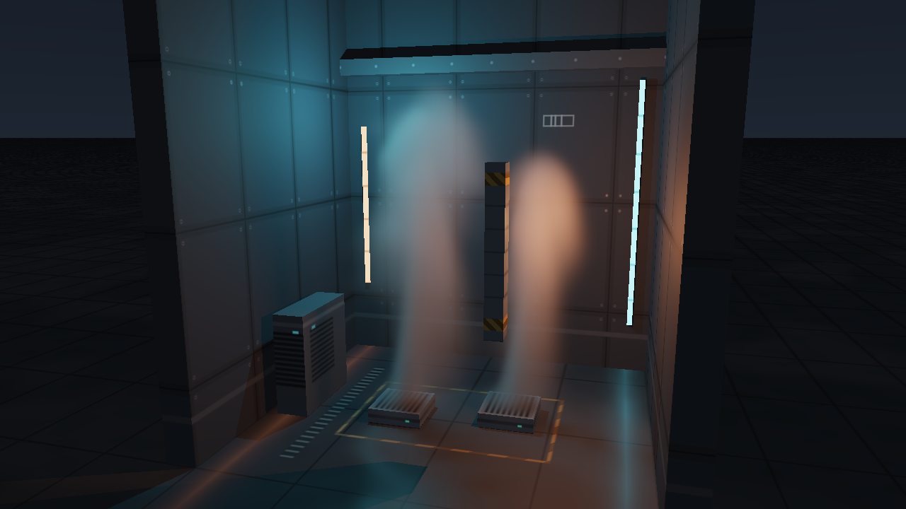
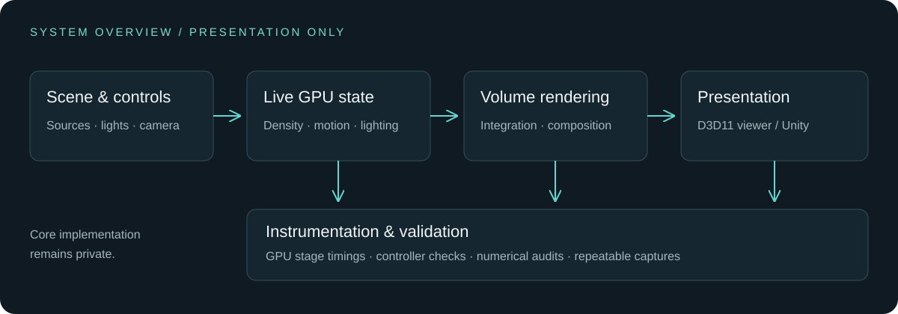
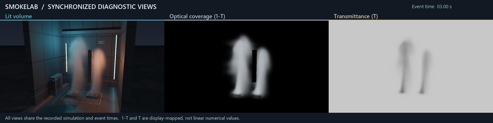

# SmokeLab · Dynamic Volumes

### Real-time volumetric graphics, made inspectable.

**A research collaboration showcase by [cusdn](https://github.com/cusdn).** GPU smoke simulation, dynamic volumetric lighting, and a native-to-Unity compute pipeline.

[12-second demonstration](assets/smoke.mp4) · [Synchronized diagnostics](assets/diagnostics.mp4) · [Architecture](assets/architecture.svg) · [Measured results](RESULTS.md)

## Research question

How can a dynamic volumetric effect remain responsive and visually interpretable while its complete GPU cost and numerical behavior remain measurable?

This project provides an interactive experimental system for studying that question. It is an engineering implementation of established techniques, not a claim of a new rendering method or an accepted publication.

## System & contribution areas

- Implemented a live 64³ GPU smoke pipeline with editable sources, forces and lighting.
- Integrated volumetric self-shadowing, analytic scene occlusion and depth-compatible composition into a D3D11 viewer.
- Built an isolated Unity 6 algorithm adapter using the same high-level parameter contract.
- Instrumented GPU stages and controller-state checks; prepared repeatable captures and independent numerical audits.

These are project contribution areas supported by the artifacts. No claim of sole authorship, an external collaboration, or a formal publication is implied.

## Measured results

RTX 3070 Ti Laptop; **1280×720 display**, **640×360 volume rendering**, **64³ simulation**. Three repeats, 60 warm-up and 300 measured frames each; UI enabled and image readback disabled.

| Repeat | Frame wall P95 | GPU span P95 | Valid samples |
|---|---:|---:|---:|
| 1 | 16.053 ms | 5.859 ms | 300/300 |
| 2 | 15.954 ms | 5.791 ms | 300/300 |
| 3 | 15.932 ms | 5.793 ms | 300/300 |

All three passed a predefined 33.333 ms engineering gate. Wall and GPU timings have different scopes; the captured video is not a live FPS recording. The figures belong to the frozen R1 native executable, not to a new benchmark or a Unity performance claim.

Initial native/Unity density matched for **1,048,576 FP32 values (maximum difference 0)**. Fixed-state view and shadow sampling-refinement relative RGB L1 were **0.02295%** and **0.01132%**. Their limited scopes are described in [RESULTS.md](RESULTS.md) and [metrics.json](evidence/metrics.json).

## Collaboration directions

- Dynamic light-transport invalidation and update scheduling under a measured GPU budget.
- Converged pressure/boundary treatment and preservation of longer-term smoke structure.
- Real engine mesh-depth integration and broader cross-engine numerical validation.

## Demo website

The static site is `index.html`. Local preview: `python -m http.server 8765 --bind 127.0.0.1`, then open `http://127.0.0.1:8765/`. No dependency installation, analytics, external fonts, backend or core source code is needed.

**Repository-only showcase. GitHub Pages is not deployed.** The static page is included for local viewing; no hosted demo URL is claimed.

## Source protection

The implementation remains in a separate private repository. This clean showcase contains only presentation HTML/CSS/JS/SVG, aggregate metrics and selected procedural-scene captures. It excludes core code, model weights, private data, binaries, original Git history and restricted third-party assets. This repository does not grant access to the implementation.

Contact: [GitHub profile / cusdn](https://github.com/cusdn).
